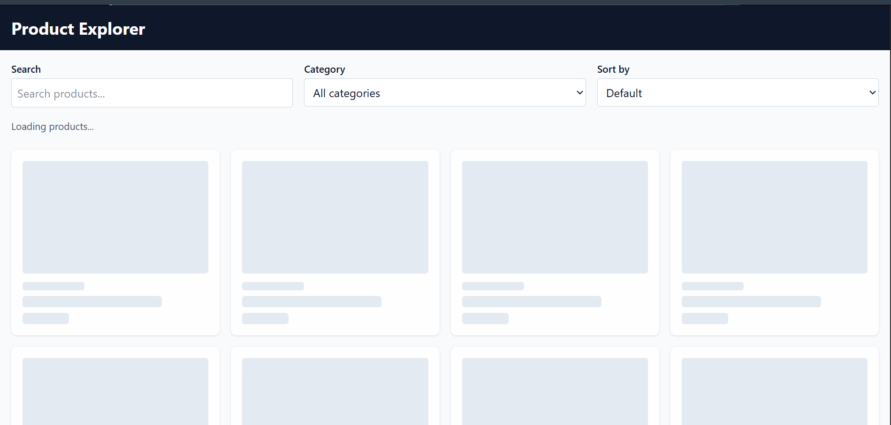
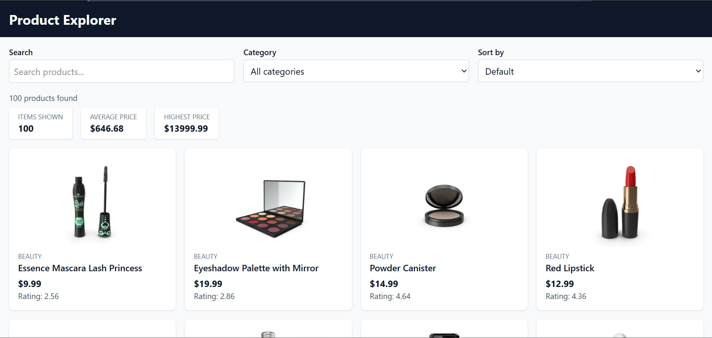
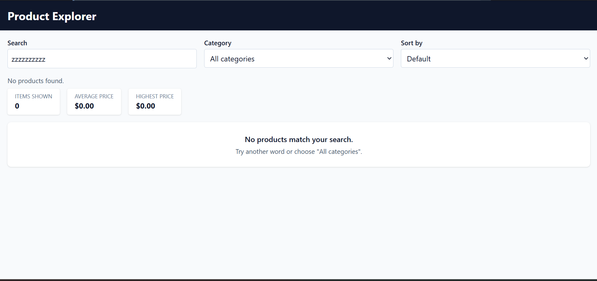
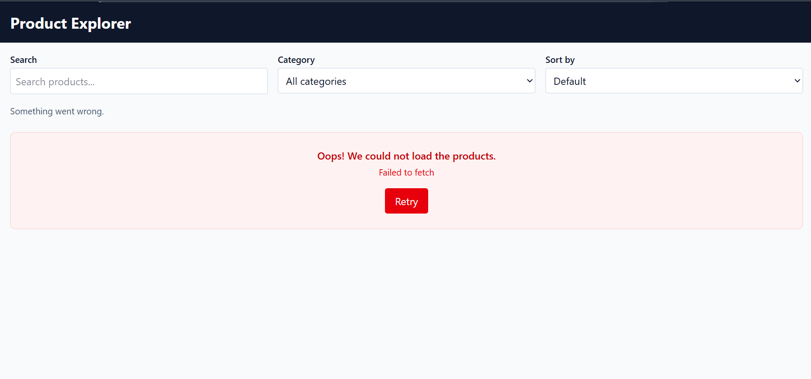

# Product Explorer (Week 5: Async Data Fetching Practice)

A single-page app that loads products from a public API. The user can browse, search, filter, sort and open product details.

- **Student:** Ineza
- **Course:** Advanced Frontend Web Development
- **API used:** DummyJSON Products ([docs](https://dummyjson.com/docs/products)). No secret key needed.

## Links

- **GitHub repository:** https://github.com/Musekura20/week5-async-data-explorer
- **Live app:** cool-lily-2309b5.netlify.app/
- **Video demonstration:** 

## Features

- [x] Data loads automatically when the page opens (`async/await` + `fetch`)
- [x] Reusable `getJSON(url)` helper that checks `response.ok` and throws a clear error
- [x] Loading state with skeleton cards (`animate-pulse`)
- [x] Error state with a friendly message and a working **Retry** button
- [x] Empty state when search or filter finds nothing
- [x] Responsive card grid (1, 2, 3, then 4 columns) built with `map` and destructuring
- [x] Live search (case-insensitive)
- [x] Category filter built from the data
- [x] Sorting: price low to high, price high to low, name A to Z (using `toSorted`)
- [x] Details popup (`<dialog>`) that fetches a single product by id (`/products/1`)
- [x] Stats bar made with `reduce` (items shown, average price, highest price)
- [x] Parallel requests with `Promise.allSettled` (products + categories)
- [x] Safe text: every API value is escaped with `escapeHTML()`
- [x] Accessibility: labeled controls, alt text, `aria-live="polite"`, keyboard-friendly cards (`<button>`)
- [x] **Bonus:** debounced search (waits 300ms after typing stops)

## Project structure

```
index.html
src/
  main.js    -> state + events + load()
  api.js     -> getJSON, getProducts, getProduct, getCategories
  render.js  -> functions that draw the screen
  utils.js   -> escapeHTML, getVisibleItems (pure helpers)
  style.css  -> Tailwind import
```

## State shape and how it works

```js
const state = {
  items: [],          // all products from the API (never changed)
  categories: [],     // category names from the API
  status: "loading",  // "loading" | "success" | "error"
  error: null,        // error message text
  query: "",          // search text
  filter: "all",      // selected category
  sort: "default",    // selected sort option
}
```

**State to render flow:**

1. An event happens (page opens, user types, user picks a category, user clicks Retry).
2. The event handler updates the `state` object.
3. `render(state)` draws the screen from the state.

`getVisibleItems(state)` is a pure function. It searches, then filters, then sorts, and returns a new list. It does not change `state.items`, and the app does not fetch again when the user searches, filters or sorts.

## Raw API JSON and how I transformed it

Shortened response from `https://dummyjson.com/products?limit=100`:

```json
{
  "products": [
    {
      "id": 1,
      "title": "Essence Mascara Lash Princess",
      "description": "A popular mascara...",
      "category": "beauty",
      "price": 9.99,
      "rating": 4.94,
      "stock": 5,
      "brand": "Essence",
      "thumbnail": "https://cdn.dummyjson.com/.../thumbnail.webp"
    }
  ],
  "total": 194,
  "skip": 0,
  "limit": 100
}
```

How I transformed it:

- Took the `products` array and saved it in `state.items`.
- `filter` keeps products whose `title` contains the search text and whose `category` matches the selected category.
- `toSorted` makes a new sorted list (the original list is not changed).
- `map` with destructuring turns each product into a card (title, category, price, image, rating).
- `price.toFixed(2)` shows the price like `$9.99`.
- `reduce` calculates the total, average and highest price for the stats bar.
- `??` gives backup values when data is missing (for example `thumbnail ?? ""`).

## Screenshots

**Loading state**



**Success state**



**Empty state**



**Error state**



## What I Have Learned in Asynchronous JavaScript

- How to fetch data from public APIs using `fetch` and `async/await`.
- To handle loading, success, empty, and error states in the UI.
- Check `response.ok` and throw meaningful error messages.
- Transform and work with API data using `map()`, `filter()`, `reduce()`, and `toSorted()`.
- Use destructuring, the spread operator, template literals, and JavaScript modules (`import`/`export`).
- Run multiple independent requests in parallel using `Promise.all()` and `Promise.allSettled()`.
- Manage UI state in one place and re-render the UI whenever the state changes.
